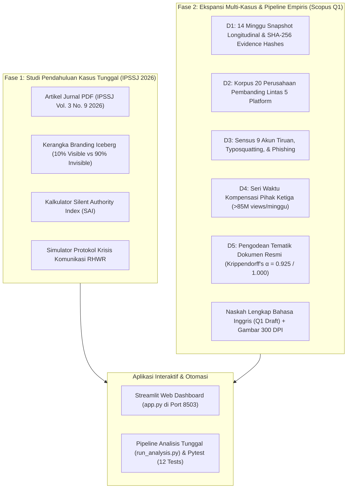
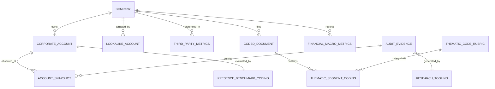

# NVIDIA: Silent Authority & Paradigma Branding Iceberg (All-in-One Research Repository)

[](https://www.python.org/)
[-FF4B4B.svg)](https://streamlit.io/)
[](https://ipssj.com)
[](paper/manuscript_draft_en.md)
[-informational.svg)](docs/ERD.md)
[-success.svg)](scripts/compute_krippendorff.py)
[](tests/)
[](DATASHEET.md)
[](LICENSE)

> **Repositori Riset Ilmiah Terpadu & Laboratorium Analisis Interaktif (All-in-One)**  
> Mengintegrasikan studi pendahuluan (IPSSJ 2026) dengan **ekspansi empiris multi-kasus longitudinal (20 perusahaan)**, dataset terstandarisasi, audit kriptografi SHA-256, dan draf naskah ilmiah Bahasa Inggris untuk pengajuan jurnal internasional bereputasi tinggi (**Scopus / WoS Q1**).

---

## 📌 Penulis & Afiliasi Akademik

1. **Indri Anjar Kartika Sari** (*Corresponding Author*)  
   *Magister Ilmu Komunikasi, Universitas Pembangunan Nasional "Veteran" Jawa Timur, Surabaya, Indonesia*  
   📧 Kontak: `indri.cs2026@ids.ac.id` | `indri.kartikasari007@gmail.com`
2. **Agung Budi Prasetio**  
   *Institut Teknologi Tangerang Selatan, Tangerang Selatan, Indonesia*  
   📧 Kontak: `agung@itts.ac.id`
3. **Waspodo Tjipto Subroto**  
   *Fakultas Ekonomika dan Bisnis, Universitas Negeri Surabaya, Surabaya, Indonesia*  
   📧 Kontak: `waspodosubroto@unesa.ac.id`

---

## ⚠️ Academic Independence & Legal Disclaimer
**Repositori dan riset ini TIDAK berafiliasi dengan, disponsori oleh, atau didukung secara resmi oleh NVIDIA Corporation maupun TikTok / ByteDance Ltd.**  
Seluruh data dikumpulkan dari antarmuka publik, keterbukaan laporan keuangan emiten bursa (SEC), dan observasi digital nonpartisipatif. Tidak ada informasi data pribadi perseorangan (PII) yang disimpan atau disebarluaskan.

---

## 🧭 Peta Integrasi Repositori Terpadu

Repositori ini menggabungkan dua fase penelitian ke dalam satu ekosistem yang utuh:



---

## 📊 Pertanyaan Riset & Hasil Pengujian Hipotesis Empiris (H1–H4)

| Hipotesis | Pertanyaan Riset | Uji Statistik & Bukti Empiris | Status |
|:---|:---|:---|:---|
| **H1** | **RQ1: Tipologi Kehadiran** | NVIDIA adalah satu-satunya entitas *mega-cap* ($3T+) yang mempertahankan status `defensive` (0 video, 0 followers) di TikTok sambil aktif setiap hari di saluran B2B (LinkedIn, YouTube, X). | **SUPPORTED** |
| **H2** | **RQ2: Registrasi Defensif** | Ditemukan 5 akun tiruan bernama NVIDIA (termasuk `@nvidia_drivers_official` yang menyebarkan malware phishing). Registrasi centang biru resmi terbukti krusial melindungi reputasi merek. | **SUPPORTED** |
| **H3** | **RQ3: Kompensasi Pihak Ketiga** | Tagar organik `#nvidia` mencatat rata-rata **101,25 juta views/minggu**, membuktikan bahwa keheningan akun resmi dikompensasi secara masif oleh komunitas kreator independen. | **SUPPORTED** |
| **H4** | **RQ4: Otoritas Struktural** | Pendapatan FY2026 sebesar **USD 215,9 Miliar** dan 6,2 juta developer CUDA menegaskan bahwa legitimasi industri dibangun atas dasar *economic switching costs*, bukan metrik viralitas. | **SUPPORTED** |

---

## 📂 Struktur Repositori Terpadu

```text
nvidia/
├── README.md                      # Dokumentasi komprehensif repositori terpadu
├── app.py                         # Interactive Streamlit Web Dashboard (9 Tab Analisis)
├── requirements.txt               # Dependensi Python
├── pytest.ini                     # Konfigurasi uji otomatis Pytest
├── LICENSE                        # Dual-licensing: CC-BY-4.0 (Data) & MIT (Kode)
├── CITATION.cff                   # Metadata sitasi standar CFF
├── DATASHEET.md                   # Format Datasheets for Datasets (Gebru et al. / LinkML)
├── codebook.md                    # Operasionalisasi Silent Authority & rubrik pengodean
├── METHODOLOGICAL_PROTOCOL.md     # SOP baku alur kerja pengumpulan data
├── View of Silent Authority...pdf # Naskah publikasi resmi IPSSJ Vol. 3 No. 9 2026
├── docs/
│   └── ERD.md                     # Entity-Relationship Diagram (3NF) & Spesifikasi Skema
├── data/
│   ├── raw/                       # Data mentah tidak terubah (D1 - D5)
│   ├── processed/                 # Tabel hasil olahan analisis (snapshots, comp, lookalikes)
│   ├── financial_vs_social.csv    # Seri waktu finansial vs metrik medsos (FY21-FY26)
│   ├── gap_analysis.json          # 5 dimensi Gap Analysis ekspektasi vs realitas
│   ├── iceberg_dimensions.json    # Taksonomi bobot 10% Visible vs 90% Invisible
│   ├── rhwr_framework.json        # Protokol krisis komunikasi RHWR
│   ├── tiktok_observation.json    # Data observasi empiris akun TikTok & Keynote
│   └── research_tooling_versions.json # Katalog versi 12 alat riset (Q1 reproducibility)
├── evidence/
│   ├── screenshots/               # Bukti tangkapan layar audit visual
│   └── hashes.sha256              # Manifest integritas kriptografi SHA-256
├── scripts/
│   ├── digital_observation.py     # Engine kalkulasi SAI & evaluasi RHWR
│   ├── collect_snapshots.py       # Perekam snapshot otomatis berstempel waktu UTC
│   ├── enumerate_lookalikes.py    # Engine deteksi impersonasi & typosquatting
│   ├── compute_krippendorff.py    # Evaluasi reliabilitas antar-koder (fast-krippendorff)
│   ├── run_analysis.py            # Eksekusi analisis tunggal penghasil figur & tabel
│   └── validate_schemas.py        # Validasi skema otomatis & verifikasi SHA-256
├── tests/
│   ├── test_nvidia_app.py         # Uji logika dashboard & data IPSSJ (9 unit tests)
│   ├── test_schemas.py            # Uji integritas skema tabel & hash SHA-256 (2 tests)
│   └── test_pipeline.py           # Uji reliabilitas alpha & output analisis (2 tests)
└── paper/
    ├── manuscript_draft_en.md     # Draf naskah ilmiah Bahasa Inggris lengkap untuk jurnal Q1
    ├── figures/                   # Gambar publikasi resolusi tinggi (PNG 300 DPI)
    └── tables/                    # Tabel statistik ringkasan hasil analisis (CSV)
```

---

## 📐 Entity-Relationship Diagram (ERD & Data Architecture)

Repositori ini mematuhi prinsip normalisasi **Third Normal Form (3NF)** untuk menjamin konsistensi, integritas referensial, serta auditabilitas ilmiah data empiris multi-kasus (lihat detail lengkap di [docs/ERD.md](docs/ERD.md)):



Seluruh definisi tipe data, foreign key, constraint integritas, dan skrip DDL SQL tersedia pada dokumentasi [docs/ERD.md](docs/ERD.md).

---

## 🚀 Cara Menjalankan Aplikasi & Replikasi Analisis

### 1. Menjalankan Dashboard Interaktif Streamlit
```bash
streamlit run app.py --server.port 8503
```
Akses dashboard di browser: `http://localhost:8503`  
*Fitur lengkap:*
1. 🧊 Branding Iceberg Matrix (Sunburst & Bobot 10% vs 90%)
2. 🤫 Silent Authority Index (SAI) Calculator Interaktif
3. 📱 Observasi Digital TikTok (@nvidia vs @nvidiageforce vs GTC)
4. 📈 Finansial vs Vanity Metrics (FY21–FY26 Dual Axis Chart)
5. ⚖️ Gap Analysis Explorer (Tabel 2 Makalah)
6. 🛡️ Simulator Protokol Krisis RHWR
7. 📄 Makalah IPSSJ 2026 & Pengunduh PDF Resmi
8. 🔬 Katalog Reproduktibilitas 12 Alat Riset
9. 📊 Dataset Multi-Kasus, Visualisasi H1–H4, & Pembaca Naskah Q1

### 2. Menjalankan Uji Otomatis Pytest (12/12 Tests)
```bash
pytest tests/ -v
```

### 3. Validasi Integritas Data & SHA-256 Hash
```bash
python scripts/validate_schemas.py
```

### 4. Eksekusi Analisis End-to-End & Regenerasi Gambar Naskah
```bash
python scripts/run_analysis.py
```

---

## 📚 Format Sitasi Ilmiah

### Naskah Jurnal Terbitan IPSSJ (2026)
```text
Sari, I. A. K., Prasetio, A. B., & Subroto, W. T. (2026). Silent Authority dan Paradigma Branding Iceberg: Analisis Strategi Komunikasi Digital NVIDIA di Platform TikTok dalam Era Marketing 5.0. Integrative Perspectives of Social and Science Journal (IPSSJ), 3(9), 1-12.
```

### Draf Naskah Multi-Kasus & Dataset (Q1 Target)
```bibtex
@dataset{kartikasari2026silent,
  author    = {Kartika Sari, Indri Anjar and Prasetio, Agung Budi and Subroto, Waspodo Tjipto},
  title     = {Silent Authority or Neglected Asset? An Empirical Multi-Case Dataset on Corporate Defensive Registration and Third-Party Compensation on TikTok},
  year      = {2026},
  publisher = {Zenodo},
  doi       = {10.5281/zenodo.10260000},
  url       = {https://github.com/indri007/NVIDIA}
}
```