# Entity-Relationship Diagram (ERD): NVIDIA Silent Authority & Multi-Case Corporate Presence

> **Dokumentasi Arsitektur Data Relasional Riset Akademik**  
> **Studi:** *Silent Authority dan Paradigma Branding Iceberg: Analisis Strategi Komunikasi Digital NVIDIA di Platform TikTok dalam Era Marketing 5.0*  
> **Standar Kepatuhan:** Scopus / WoS Q1 Open Science, FAIR Principles, Gebru et al. (2021) Datasheet Standard.  
> **Penulis:** Indri Anjar Kartika Sari, Agung Budi Prasetio, Waspodo Tjipto Subroto (2026)

---

## 1. Ikhtisar Arsitektur Data

Arsitektur data ini dibangun dalam bentuk **Relational Normalized Schema (3NF)** untuk mengintegrasikan data empiris observasional, bukti kriptografis, korpus teks kualitatif, serta metrik keuangan makro. Skema ini secara langsung mendukung pengujian empat Hipotesis Riset (H1–H4) yang diturunkan dalam PRD:

- **H1 (Kehadiran Defensif vs Pembanding):** Relasi antara `COMPANY`, `CORPORATE_ACCOUNT`, `PRESENCE_BENCHMARK_CODING`, dan `ACCOUNT_SNAPSHOT`.
- **H2 (Registrasi Defensif vs Cybersquatting):** Relasi antara `COMPANY`, `CORPORATE_ACCOUNT` (presence = 'defensive'), dan sensus `LOOKALIKE_ACCOUNT`.
- **H3 (Kompensasi Wacana Pihak Ketiga):** Relasi antara `COMPANY`, keheningan `ACCOUNT_SNAPSHOT` (followers=0, uploads=0), dan volume wacana pada `THIRD_PARTY_METRICS`.
- **H4 & Iceberg Paradigm (Otoritas Struktural vs Vanity Metrics):** Relasi antara `COMPANY`, `FINANCIAL_MACRO_METRICS` (dominasi CUDA & Pusat Data), serta segmen kualitatif `CODED_DOCUMENT` dan `THEMATIC_CODE_RUBRIC`.
- **Auditability & SOP Kriptografis (Q1 Standard):** Relasi antara `ACCOUNT_SNAPSHOT`, `AUDIT_EVIDENCE` (SHA-256), dan `RESEARCH_TOOLING`.

---

## 2. Entity-Relationship Diagram (Mermaid)

```mermaid
erDiagram
    COMPANY ||--o{ CORPORATE_ACCOUNT : owns
    COMPANY ||--o{ LOOKALIKE_ACCOUNT : targeted_by
    COMPANY ||--o{ THIRD_PARTY_METRICS : referenced_in
    COMPANY ||--o{ CODED_DOCUMENT : files
    COMPANY ||--o{ FINANCIAL_MACRO_METRICS : reports

    CORPORATE_ACCOUNT ||--o{ ACCOUNT_SNAPSHOT : observed_at
    CORPORATE_ACCOUNT ||--|| PRESENCE_BENCHMARK_CODING : evaluated_by

    AUDIT_EVIDENCE ||--o{ ACCOUNT_SNAPSHOT : verifies
    AUDIT_EVIDENCE }o--|| RESEARCH_TOOLING : generated_by

    CODED_DOCUMENT ||--o{ THEMATIC_SEGMENT_CODING : contains
    THEMATIC_CODE_RUBRIC ||--o{ THEMATIC_SEGMENT_CODING : categorizes

    COMPANY {
        string company_id PK "Kode unik korporasi (e.g. NVDA, AMD)"
        string company_name "Nama resmi korporasi"
        string sector "Sektor industri (Semiconductors, Big Tech, SaaS)"
        string business_model "Model bisnis (B2B & Consumer, Pure B2B)"
        string market_cap_tier "Kategori kapitalisasi pasar"
        string headquarters_country "Negara kantor pusat"
    }

    CORPORATE_ACCOUNT {
        string account_id PK "ID unik akun korporasi"
        string company_id FK "Referensi ke entitas korporasi"
        string platform "Nama platform (TikTok, X, LinkedIn, YouTube)"
        string handle "Handle profil media sosial"
        string account_type "Tipe akun (Corporate Official, Sub-brand)"
        boolean verified "Status verifikasi lencana resmi"
    }

    PRESENCE_BENCHMARK_CODING {
        string coding_id PK "ID unik evaluasi kehadiran"
        string account_id FK "Referensi ke akun korporasi"
        string presence_type "Klasifikasi tipe kehadiran (active, defensive, dormant, placeholder)"
        string coder_1 "Penetapan kode koder 1"
        string coder_2 "Penetapan kode koder 2"
        string adjudicated_type "Ground truth hasil rekonsiliasi"
        string notes "Catatan kualitatif observasi"
    }

    ACCOUNT_SNAPSHOT {
        string snapshot_id PK "ID unik snapshot observasi"
        string account_id FK "Referensi ke akun korporasi"
        string captured_at_utc "Stempel waktu UTC observasi"
        int followers "Jumlah pengikut"
        int following "Jumlah akun yang diikuti"
        bigint likes "Akumulasi suka"
        int video_count "Jumlah video terunggah"
        boolean verified "Status verifikasi centang resmi"
        string evidence_file "Relatif path berkas screenshot"
        string sha256 FK "Hash integritas berkas bukti"
    }

    AUDIT_EVIDENCE {
        string sha256 PK "SHA-256 hash intisari kriptografis (64 karakter hex)"
        string file_path "Path berkas screenshot arsip"
        string file_type "Format berkas (PNG, HTML, JSON)"
        string captured_by_tool FK "Nama tool pengumpul bukti"
        int file_size_bytes "Ukuran berkas dalam byte"
        string captured_timestamp "Waktu perekaman bukti"
    }

    LOOKALIKE_ACCOUNT {
        string lookalike_id PK "ID unik akun tiruan"
        string brand_target FK "Referensi perusahaan yang ditiru"
        string platform "Platform media sosial"
        string handle "Handle akun tiruan / squatting"
        date found_at "Tanggal penemuan akun"
        string reason "Alasan kategorisasi ancaman merek"
        string status "Status akun (phishing_flagged, unverified_fan)"
        string risk_level "Tingkat risiko (High, Medium, Low)"
    }

    THIRD_PARTY_METRICS {
        string metric_id PK "ID unik metrik kompensasi"
        string company_id FK "Referensi ke korporasi target"
        string source "Sumber data (TikTok Hashtag, Google Trends, Media)"
        string query "Kata kunci / kueri pencarian"
        date week_start "Tanggal awal pekan observasi"
        bigint volume "Volume penayangan / pencarian / artikel"
        float sentiment_score "Skor sentimen sentimen agregat (0-1)"
    }

    CODED_DOCUMENT {
        string doc_id PK "ID unik dokumen korporat"
        string company_id FK "Referensi korporasi penerbit"
        string document_type "Tipe dokumen (SEC 10-K, GTC Keynote, Earnings Call)"
        date filing_date "Tanggal rilis / publikasi dokumen"
        string primary_source_url "Tautan arsip primer dokumen"
    }

    THEMATIC_SEGMENT_CODING {
        string segment_id PK "ID unik segmen teks terkode"
        string doc_id FK "Referensi dokumen asal"
        string code_id FK "Referensi kode tematik codebook"
        string coder_id "Identitas koder (coder_1, coder_2)"
        string excerpt_ref "Kutipan teks dan nomor halaman / item"
    }

    THEMATIC_CODE_RUBRIC {
        string code_id PK "Kode tematik (e.g. CODE_CUDA_MOAT)"
        string construct_name "Nama konstruk teoretis"
        string theoretical_pillar "Pilar teori (Signaling, Silence, Moat)"
        string operational_definition "Definisi operasional pengodean"
    }

    FINANCIAL_MACRO_METRICS {
        string financial_id PK "ID unik metrik keuangan"
        string company_id FK "Referensi korporasi"
        string fiscal_year "Tahun fiskal (FY21 - FY26)"
        float revenue_usd_billion "Pendapatan tahunan (miliar USD)"
        float datacenter_rev_percent "Persentase pendapatan data center"
        float cuda_developers_million "Jumlah developer CUDA (juta)"
        int tiktok_corp_uploads "Unggahan TikTok akun korporat"
        int tiktok_corp_followers "Pengikut TikTok akun korporat"
        float market_cap_trillion_usd "Kapitalisasi pasar (triliun USD)"
    }

    RESEARCH_TOOLING {
        string tool_id PK "ID unik katalog alat"
        string tool_name "Nama repositori alat (4cat, zeeschuimer, dll)"
        string developer "Pengembang alat"
        string commit_hash "Commit hash git yang dipin"
        string version "Versi rilis"
        string purpose "Fungsi operasional dalam riset"
    }
```



---

## 3. Kamus Data & Spesifikasi Entitas Relasional

### 3.1. Entitas Inti Korporasi & Akun (`COMPANY` & `CORPORATE_ACCOUNT`)
| Kolom | Tipe Data | Constraint | Keterangan |
| :--- | :--- | :--- | :--- |
| `company_id` | VARCHAR(16) | PRIMARY KEY | Identifikasi unik entitas (e.g., `NVDA`, `AMD`, `INTC`, `MSFT`). |
| `company_name` | VARCHAR(128) | NOT NULL | Nama resmi entitas korporat. |
| `sector` | VARCHAR(64) | NOT NULL | Kluster sektor industri (`Semiconductors (AI / GPU)`, `Big Tech Platform`, dll). |
| `business_model` | VARCHAR(64) | NOT NULL | Model operasional bisnis (`B2B & Consumer`, `Pure B2B`, dll). |
| `market_cap_tier` | VARCHAR(32) | NOT NULL | Tier kapitalisasi pasar (`Mega-Cap`, `Large-Cap`). |

| Kolom | Tipe Data | Constraint | Keterangan |
| :--- | :--- | :--- | :--- |
| `account_id` | VARCHAR(32) | PRIMARY KEY | ID unik akun media sosial (`ACC_NV_CORP`, `ACC_NV_GEFORCE`, dll). |
| `company_id` | VARCHAR(16) | FOREIGN KEY -> `COMPANY(company_id)` | Korporasi pemilik akun. |
| `platform` | VARCHAR(32) | NOT NULL | Nama platform (`TikTok`, `X`, `LinkedIn`, `YouTube`, `Instagram`). |
| `handle` | VARCHAR(64) | NOT NULL | Nama handle publik akun (e.g. `@nvidia`, `@nvidiageforce`). |
| `account_type` | VARCHAR(32) | NOT NULL | Tipe representasi akun (`Corporate Official`, `Consumer Sub-brand`). |
| `verified` | BOOLEAN | NOT NULL | Status verifikasi resmi platform (`TRUE`/`FALSE`). |

---

### 3.2. Dataset D1: Longitudinal Account Snapshots (`ACCOUNT_SNAPSHOT`)
File: `data/processed/snapshots_account.csv` (56 observasi mingguan)

| Kolom | Tipe Data | Constraint | Keterangan |
| :--- | :--- | :--- | :--- |
| `snapshot_id` | VARCHAR(64) | PRIMARY KEY | Pengenal unik observasi snapshot mingguan. |
| `account_id` | VARCHAR(32) | FOREIGN KEY -> `CORPORATE_ACCOUNT(account_id)` | Akun yang diobservasi. |
| `captured_at_utc` | TIMESTAMP WITH TIME ZONE | NOT NULL | Stempel waktu ISO 8601 pencatatan snapshot (UTC). |
| `followers` | INTEGER | NOT NULL, DEFAULT 0 | Jumlah followers publik akun. |
| `following` | INTEGER | NOT NULL, DEFAULT 0 | Jumlah akun yang diikuti. |
| `likes` | BIGINT | NOT NULL, DEFAULT 0 | Akumulasi likes pada seluruh konten. |
| `video_count` | INTEGER | NOT NULL, DEFAULT 0 | Jumlah video publik yang diunggah. |
| `verified` | BOOLEAN | NOT NULL | Status tanda verifikasi saat observasi. |
| `bio` | TEXT | NULLABLE | Deskripsi profil bio akun saat observasi. |
| `evidence_file` | VARCHAR(255) | NOT NULL | Path relatif bukti tangkapan layar di `evidence/screenshots/`. |
| `sha256` | CHAR(64) | FOREIGN KEY -> `AUDIT_EVIDENCE(sha256)` | Hash SHA-256 integritas berkas screenshot bukti audit. |

---

### 3.3. Integritas Bukti Visual Kriptografis (`AUDIT_EVIDENCE`)
File: `evidence/hashes.sha256` & direktori `evidence/screenshots/`

| Kolom | Tipe Data | Constraint | Keterangan |
| :--- | :--- | :--- | :--- |
| `sha256` | CHAR(64) | PRIMARY KEY | Digest hash SHA-256 256-bit hexadecimal unik dari berkas bukti visual. |
| `file_path` | VARCHAR(255) | NOT NULL, UNIQUE | Jalur relatif berkas bukti terhadap root repositori. |
| `file_type` | VARCHAR(16) | NOT NULL | Format berkas bukti (`PNG`, `PDF`, `WARC`). |
| `captured_by_tool` | VARCHAR(64) | FOREIGN KEY -> `RESEARCH_TOOLING(tool_name)` | Alat riset yang digunakan untuk capturing. |
| `file_size_bytes` | BIGINT | NOT NULL | Ukuran fisik berkas bukti dalam satuan byte. |
| `captured_timestamp` | TIMESTAMP | NOT NULL | Waktu pembuatan berkas bukti. |

---

### 3.4. Dataset D2: Benchmark Korpus 20 Perusahaan & Inter-Coder Coding (`PRESENCE_BENCHMARK_CODING`)
File: `data/processed/comparison_accounts.csv`

| Kolom | Tipe Data | Constraint | Keterangan |
| :--- | :--- | :--- | :--- |
| `coding_id` | VARCHAR(32) | PRIMARY KEY | Pengenal unik baris pengodean komparatif. |
| `account_id` | VARCHAR(32) | FOREIGN KEY -> `CORPORATE_ACCOUNT(account_id)` | Akun yang diklasifikasikan. |
| `presence_type` | VARCHAR(16) | NOT NULL, CHECK in (`active`, `defensive`, `dormant`, `placeholder`) | Kategori tipologi kehadiran digital akhir. |
| `coder_1` | VARCHAR(16) | NOT NULL | Hasil pengodean independen oleh Koder 1. |
| `coder_2` | VARCHAR(16) | NOT NULL | Hasil pengodean independen oleh Koder 2. |
| `adjudicated_type` | VARCHAR(16) | NOT NULL | Nilai konsensus jika terjadi perbedaan antar koder. |
| `notes` | TEXT | NULLABLE | Catatan kualitatif karakteristik aktivitas akun. |

---

### 3.5. Dataset D3: Sensus Akun Tiruan & Cybersquatting (`LOOKALIKE_ACCOUNT`)
File: `data/processed/lookalike_accounts.csv`

| Kolom | Tipe Data | Constraint | Keterangan |
| :--- | :--- | :--- | :--- |
| `lookalike_id` | VARCHAR(32) | PRIMARY KEY | ID unik akun tiruan. |
| `brand_target` | VARCHAR(16) | FOREIGN KEY -> `COMPANY(company_id)` | Korporasi target peniruan identitas merek. |
| `platform` | VARCHAR(32) | NOT NULL | Platform tempat akun tiruan beroperasi (`TikTok`, dll). |
| `handle` | VARCHAR(64) | NOT NULL | Nama handle akun tiruan. |
| `found_at` | DATE | NOT NULL | Tanggal deteksi awal akun oleh tim riset. |
| `reason` | TEXT | NOT NULL | Indikasi modus (`Typosquatting`, `Phishing driver downloads`, `Fan re-uploader`). |
| `status` | VARCHAR(32) | NOT NULL | Status klasifikasi teknis (`phishing_flagged`, `unverified_fan`, `community_unofficial`). |
| `risk_level` | VARCHAR(16) | NOT NULL | Estimasi tingkat ancaman identitas (`High`, `Medium`, `Low`). |

---

### 3.6. Dataset D4: Kompensasi Wacana Pihak Ketiga (`THIRD_PARTY_METRICS`)
File: `data/processed/third_party_series.csv`

| Kolom | Tipe Data | Constraint | Keterangan |
| :--- | :--- | :--- | :--- |
| `metric_id` | VARCHAR(32) | PRIMARY KEY | Pengenal unik baris deret waktu pihak ketiga. |
| `company_id` | VARCHAR(16) | FOREIGN KEY -> `COMPANY(company_id)` | Korporasi yang menjadi objek perbincangan. |
| `source` | VARCHAR(64) | NOT NULL | Sumber data (`TikTok Hashtag`, `Google Trends`, `Global Tech Media`). |
| `query` | VARCHAR(128) | NOT NULL | Kueri pencarian atau tagar (`#nvidia`, `#nvidiageforce`, `NVIDIA AI Blackwell`). |
| `week_start` | DATE | NOT NULL | Tanggal awal pekan pengamatan longitudinal. |
| `volume` | BIGINT | NOT NULL | Volume agregat (penayangan tagar, indeks tren 0-100, atau jumlah publikasi berita). |
| `sentiment_score` | NUMERIC(4,3) | NOT NULL, CHECK (sentiment_score BETWEEN 0.0 AND 1.0) | Skor sentimen polaritas wacana publik. |

---

### 3.7. Dataset D5: Korpus Dokumen Korporat Terkode (`CODED_DOCUMENT` & `THEMATIC_SEGMENT_CODING`)
File: `data/processed/documents_coded.csv`

| Kolom | Tipe Data | Constraint | Keterangan |
| :--- | :--- | :--- | :--- |
| `doc_id` | VARCHAR(32) | PRIMARY KEY | ID unik dokumen korporat (e.g. `DOC_10K_FY26_01`, `DOC_GTC26_01`). |
| `company_id` | VARCHAR(16) | FOREIGN KEY -> `COMPANY(company_id)` | Perusahaan penerbit dokumen resmi. |
| `document_type` | VARCHAR(64) | NOT NULL | Jenis dokumen (`SEC 10-K Filing`, `GTC Keynote Transcript`, `Earnings Call`). |
| `filing_date` | DATE | NOT NULL | Tanggal resmi penerbitan dokumen. |
| `primary_source_url` | VARCHAR(255) | NOT NULL | Tautan permanen pengarsipan dokumen resmi. |

| Kolom | Tipe Data | Constraint | Keterangan |
| :--- | :--- | :--- | :--- |
| `segment_id` | VARCHAR(32) | PRIMARY KEY | ID unik kutipan segmen teks. |
| `doc_id` | VARCHAR(32) | FOREIGN KEY -> `CODED_DOCUMENT(doc_id)` | Dokumen asal kutipan. |
| `code_id` | VARCHAR(32) | FOREIGN KEY -> `THEMATIC_CODE_RUBRIC(code_id)` | Kode tematik berdasarkan rubrik codebook. |
| `coder_id` | VARCHAR(16) | NOT NULL | Identitas koder (`coder_1`, `coder_2`). |
| `excerpt_ref` | TEXT | NOT NULL | Kutipan teks dan referensi bagian (`Item 1`, `Keynote min 12:40`). |

---

### 3.8. Fundamental Finansial vs Metrik Sosial (`FINANCIAL_MACRO_METRICS`)
File: `data/financial_vs_social.csv`

| Kolom | Tipe Data | Constraint | Keterangan |
| :--- | :--- | :--- | :--- |
| `financial_id` | VARCHAR(16) | PRIMARY KEY | ID gabungan korporasi & tahun fiskal (e.g. `NVDA_FY26`). |
| `company_id` | VARCHAR(16) | FOREIGN KEY -> `COMPANY(company_id)` | Korporasi terkait. |
| `fiscal_year` | VARCHAR(8) | NOT NULL | Periode tahun fiskal (`FY21` hingga `FY26`). |
| `revenue_usd_billion` | NUMERIC(10,2) | NOT NULL | Pendapatan tahunan bersih dalam miliar USD. |
| `datacenter_rev_percent` | NUMERIC(5,2) | NOT NULL | Porsi kontribusi pendapatan segmen komputasi AI / Data Center (%). |
| `cuda_developers_million` | NUMERIC(5,2) | NOT NULL | Ekosistem developer terdaftar pada software stack CUDA (juta). |
| `tiktok_corp_uploads` | INTEGER | NOT NULL, DEFAULT 0 | Jumlah video TikTok akun korporat resmi (`@nvidia` = 0). |
| `tiktok_corp_followers` | INTEGER | NOT NULL, DEFAULT 0 | Jumlah pengikut TikTok akun korporat resmi (`@nvidia` = 0). |
| `market_cap_trillion_usd` | NUMERIC(6,3) | NOT NULL | Valuasi kapitalisasi pasar saham dalam triliun USD. |

---

### 3.9. Metadata Katalog Alat Riset Reproduktif (`RESEARCH_TOOLING`)
File: `data/research_tooling_versions.json`

| Kolom | Tipe Data | Constraint | Keterangan |
| :--- | :--- | :--- | :--- |
| `tool_id` | VARCHAR(32) | PRIMARY KEY | ID entri alat riset (`TOOL_4CAT`, `TOOL_KRIPPENDORFF`, dll). |
| `tool_name` | VARCHAR(64) | NOT NULL, UNIQUE | Nama repositori / package alat riset. |
| `developer` | VARCHAR(64) | NOT NULL | Organisasi atau peneliti pengembang alat. |
| `repository_url` | VARCHAR(255) | NOT NULL | URI repositori Git resmi. |
| `commit_hash` | CHAR(40) | NOT NULL | Git commit hash 40 karakter hex yang dipin demi reproduksibilitas. |
| `version` | VARCHAR(32) | NOT NULL | Tag versi rilis perangkat lunak. |
| `purpose` | TEXT | NOT NULL | Fungsi spesifik instrumen dalam pengumpulan dan pengujian data. |

---

## 4. Skrip DDL Database (PostgreSQL / DuckDB / BigQuery Compatible)

```sql
-- DDL Schema Initialization: NVIDIA Silent Authority Research Data Architecture
CREATE TABLE IF NOT EXISTS company (
    company_id VARCHAR(16) PRIMARY KEY,
    company_name VARCHAR(128) NOT NULL,
    sector VARCHAR(64) NOT NULL,
    business_model VARCHAR(64) NOT NULL,
    market_cap_tier VARCHAR(32) NOT NULL,
    headquarters_country VARCHAR(64) NOT NULL
);

CREATE TABLE IF NOT EXISTS corporate_account (
    account_id VARCHAR(32) PRIMARY KEY,
    company_id VARCHAR(16) NOT NULL REFERENCES company(company_id) ON DELETE CASCADE,
    platform VARCHAR(32) NOT NULL,
    handle VARCHAR(64) NOT NULL,
    account_type VARCHAR(32) NOT NULL,
    verified BOOLEAN NOT NULL DEFAULT FALSE
);

CREATE TABLE IF NOT EXISTS research_tooling (
    tool_name VARCHAR(64) PRIMARY KEY,
    developer VARCHAR(64) NOT NULL,
    repository_url VARCHAR(255) NOT NULL,
    commit_hash CHAR(40) NOT NULL,
    version VARCHAR(32) NOT NULL,
    purpose TEXT NOT NULL
);

CREATE TABLE IF NOT EXISTS audit_evidence (
    sha256 CHAR(64) PRIMARY KEY,
    file_path VARCHAR(255) NOT NULL UNIQUE,
    file_type VARCHAR(16) NOT NULL,
    captured_by_tool VARCHAR(64) REFERENCES research_tooling(tool_name),
    file_size_bytes BIGINT NOT NULL,
    captured_timestamp TIMESTAMP NOT NULL
);

CREATE TABLE IF NOT EXISTS account_snapshot (
    snapshot_id VARCHAR(64) PRIMARY KEY,
    account_id VARCHAR(32) NOT NULL REFERENCES corporate_account(account_id) ON DELETE CASCADE,
    captured_at_utc TIMESTAMP WITH TIME ZONE NOT NULL,
    followers INTEGER NOT NULL DEFAULT 0,
    following INTEGER NOT NULL DEFAULT 0,
    likes BIGINT NOT NULL DEFAULT 0,
    video_count INTEGER NOT NULL DEFAULT 0,
    verified BOOLEAN NOT NULL DEFAULT FALSE,
    bio TEXT,
    evidence_file VARCHAR(255) NOT NULL,
    sha256 CHAR(64) NOT NULL REFERENCES audit_evidence(sha256)
);

CREATE TABLE IF NOT EXISTS presence_benchmark_coding (
    coding_id VARCHAR(32) PRIMARY KEY,
    account_id VARCHAR(32) NOT NULL REFERENCES corporate_account(account_id) ON DELETE CASCADE,
    presence_type VARCHAR(16) NOT NULL CHECK (presence_type IN ('active', 'defensive', 'dormant', 'placeholder')),
    coder_1 VARCHAR(16) NOT NULL,
    coder_2 VARCHAR(16) NOT NULL,
    adjudicated_type VARCHAR(16) NOT NULL,
    notes TEXT
);

CREATE TABLE IF NOT EXISTS lookalike_account (
    lookalike_id VARCHAR(32) PRIMARY KEY,
    brand_target VARCHAR(16) NOT NULL REFERENCES company(company_id) ON DELETE CASCADE,
    platform VARCHAR(32) NOT NULL,
    handle VARCHAR(64) NOT NULL,
    found_at DATE NOT NULL,
    reason TEXT NOT NULL,
    status VARCHAR(32) NOT NULL,
    risk_level VARCHAR(16) NOT NULL
);

CREATE TABLE IF NOT EXISTS third_party_metrics (
    metric_id VARCHAR(32) PRIMARY KEY,
    company_id VARCHAR(16) NOT NULL REFERENCES company(company_id) ON DELETE CASCADE,
    source VARCHAR(64) NOT NULL,
    query VARCHAR(128) NOT NULL,
    week_start DATE NOT NULL,
    volume BIGINT NOT NULL,
    sentiment_score NUMERIC(4,3) NOT NULL CHECK (sentiment_score BETWEEN 0.0 AND 1.0)
);

CREATE TABLE IF NOT EXISTS thematic_code_rubric (
    code_id VARCHAR(32) PRIMARY KEY,
    construct_name VARCHAR(128) NOT NULL,
    theoretical_pillar VARCHAR(128) NOT NULL,
    operational_definition TEXT NOT NULL
);

CREATE TABLE IF NOT EXISTS coded_document (
    doc_id VARCHAR(32) PRIMARY KEY,
    company_id VARCHAR(16) NOT NULL REFERENCES company(company_id) ON DELETE CASCADE,
    document_type VARCHAR(64) NOT NULL,
    filing_date DATE NOT NULL,
    primary_source_url VARCHAR(255) NOT NULL
);

CREATE TABLE IF NOT EXISTS thematic_segment_coding (
    segment_id VARCHAR(32) PRIMARY KEY,
    doc_id VARCHAR(32) NOT NULL REFERENCES coded_document(doc_id) ON DELETE CASCADE,
    code_id VARCHAR(32) NOT NULL REFERENCES thematic_code_rubric(code_id),
    coder_id VARCHAR(16) NOT NULL,
    excerpt_ref TEXT NOT NULL
);

CREATE TABLE IF NOT EXISTS financial_macro_metrics (
    financial_id VARCHAR(16) PRIMARY KEY,
    company_id VARCHAR(16) NOT NULL REFERENCES company(company_id) ON DELETE CASCADE,
    fiscal_year VARCHAR(8) NOT NULL,
    revenue_usd_billion NUMERIC(10,2) NOT NULL,
    datacenter_rev_percent NUMERIC(5,2) NOT NULL,
    cuda_developers_million NUMERIC(5,2) NOT NULL,
    tiktok_corp_uploads INTEGER NOT NULL DEFAULT 0,
    tiktok_corp_followers INTEGER NOT NULL DEFAULT 0,
    tiktok_geforce_followers_million NUMERIC(6,2) NOT NULL DEFAULT 0,
    market_cap_trillion_usd NUMERIC(6,3) NOT NULL
);
```

---

## 5. Ringkasan Integritas Relasional & Kepatuhan Q1

1. **Third Normal Form (3NF) Compliance:** Setiap atribut non-kunci bergantung secara fungsional penuh hanya pada Primary Key, tanpa dependensi transitif.
2. **Keterlacakan Bukti Empiris (Audit Trail):** Setiap titik data observasi snapshot memiliki Foreign Key `sha256` yang mengikatnya ke `AUDIT_EVIDENCE`, diverifikasi dengan hash SHA-256 terhadap berkas fisik screenshot.
3. **Reproduksibilitas Antar-Peneliti (Double-Coding):** Variabel kualitatif pada tabel `presence_benchmark_coding` dan `thematic_segment_coding` mencatat identitas koder independen (`coder_1` dan `coder_2`) yang memfasilitasi audit matematis koefisien reliabilitas Krippendorff ($\alpha$).
